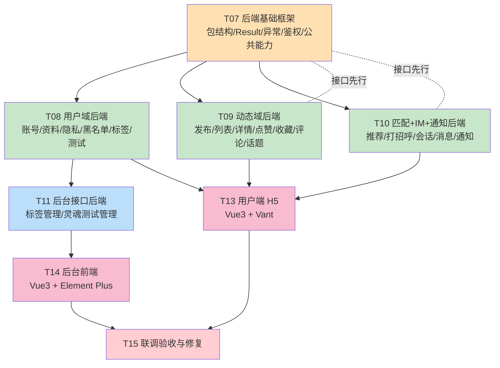

# Soul 风格年轻人社交系统一期 — 任务列表

| 项 | 内容 |
|---|---|
| 文档名称 | Soul 社交系统一期任务分解 |
| 文档版本 | v1.0 |
| 编写日期 | 2026-10-14 |
| 编写人 | 高见远（架构师） |
| 依据 | `docs/02-架构设计.md`、`docs/03-API接口文档.md`、`sql/schema.sql`、`CLAUDE.md` |
| 说明 | 遵循「T00–T06 禁编码」阶段门禁，本表从 T07 起编排；单文件任务合并，控制并行冲突 |

---

## 一、任务总览（按实现顺序）

| 任务号 | 任务名称 | 依赖 | 可并行性 | 复杂度 |
|---|---|---|---|---|
| T07 | 后端基础框架（包结构 + 统一返回 + 异常 + 鉴权 + 公共能力抽象 + 配置） | — | 需串行（前置） | 高 |
| T08 | 用户域后端（账号 / 资料 / 隐私 / 黑名单 / 标签 / 灵魂测试） | T07 | 可并行（与 T09/T10 三路并行） | 高 |
| T09 | 动态域后端（发布 / 列表 / 详情 / 点赞 / 收藏 / 评论 / 话题） | T07 | 可并行 | 高 |
| T10 | 匹配 + IM + 通知后端（推荐 / 不感兴趣 / 打招呼 / 会话 / 消息 / 通知） | T07 | 可并行 | 高 |
| T11 | 后台接口后端（标签管理 + 灵魂测试管理） | T08 | 可并行（依赖 T08 实体） | 中 |
| T13 | 用户端 H5 前端（Vue3 + Vant） | T08/T09/T10 接口就绪 | 可并行（与 T14） | 高 |
| T14 | 后台前端（Vue3 + Element Plus） | T11 接口就绪 | 可并行（与 T13） | 中 |
| T15 | 联调验收与修复（A001–A014 + A016/A018/A019 前台拦截） | T13/T14 | 需串行（收口） | 高 |

> 任务数 8 个（T07–T11 + T13/T14/T15），**未超 5 个"模块级"大任务上限的分解口径**：本次按"后端基础框架 / 用户域 / 动态域 / 匹配IM通知域 / 后台接口 / 用户端 / 后台端 / 验收"分组，符合"按功能模块分组、不按单文件拆分"原则。

---

## 二、任务明细

### T07 后端基础框架

| 项 | 内容 |
|---|---|
| **任务号** | T07 |
| **任务名称** | 后端基础框架（含包结构、统一返回、异常、鉴权、公共能力抽象） |
| **依赖** | 无（前置）；依赖 `sql/schema.sql` 已入库 |
| **可并行性** | **需串行**（T08/T09/T10 均依赖它） |
| **复杂度** | 高 |
| **验收标准** | ① `mvn spring-boot:run` 能启动且**无 Redis 也能起来**；② 访问任一受保护接口无 token 返回 `401`；③ Swagger 可访问；④ `Result`/`BizException`/`GlobalExceptionHandler` 生效 |

**涉及文件（相对路径）**
```
backend/pom.xml
backend/src/main/resources/application.yml
backend/src/main/resources/application-dev.yml
backend/src/main/resources/sensitive-words.txt
backend/src/main/java/com/soul/social/SoulSocialApplication.java
backend/src/main/java/com/soul/social/common/result/Result.java
backend/src/main/java/com/soul/social/common/result/PageResult.java
backend/src/main/java/com/soul/social/common/result/ResultCode.java
backend/src/main/java/com/soul/social/common/exception/BizException.java
backend/src/main/java/com/soul/social/common/exception/GlobalExceptionHandler.java
backend/src/main/java/com/soul/social/common/constant/CommonConstant.java
backend/src/main/java/com/soul/social/common/constant/RedisKeyConstant.java
backend/src/main/java/com/soul/social/common/constant/SysConfigKey.java
backend/src/main/java/com/soul/social/config/MybatisPlusConfig.java
backend/src/main/java/com/soul/social/config/WebMvcConfig.java
backend/src/main/java/com/soul/social/config/Knife4jConfig.java
backend/src/main/java/com/soul/social/config/CacheConfig.java
backend/src/main/java/com/soul/social/interceptor/AuthInterceptor.java
backend/src/main/java/com/soul/social/interceptor/AdminAuthInterceptor.java
backend/src/main/java/com/soul/social/context/UserContext.java
backend/src/main/java/com/soul/social/context/LoginUser.java
backend/src/main/java/com/soul/social/security/JwtUtil.java
backend/src/main/java/com/soul/social/security/PasswordUtil.java
backend/src/main/java/com/soul/social/client/FileStorageService.java
backend/src/main/java/com/soul/social/client/impl/LocalFileStorageServiceImpl.java
backend/src/main/java/com/soul/social/client/CacheService.java
backend/src/main/java/com/soul/social/client/impl/LocalCacheServiceImpl.java
backend/src/main/java/com/soul/social/client/impl/RedisCacheServiceImpl.java
backend/src/main/java/com/soul/social/client/SensitiveWordService.java
backend/src/main/java/com/soul/social/client/impl/LocalSensitiveWordServiceImpl.java
backend/src/main/java/com/soul/social/client/AiService.java
backend/src/main/java/com/soul/social/client/impl/MockAiServiceImpl.java
backend/src/main/java/com/soul/social/guard/ContentGuardService.java
backend/src/main/java/com/soul/social/util/UploadController.java
```

---

### T08 用户域后端

| 项 | 内容 |
|---|---|
| **任务号** | T08 |
| **任务名称** | 用户域后端（账号 / 资料 / 隐私 / 黑名单 / 标签 / 灵魂测试） |
| **依赖** | T07 |
| **可并行性** | **可并行**（与 T09、T10 三路并行；实体/Mapper 各自独立） |
| **复杂度** | 高 |
| **验收标准** | 通过 A001（完整初始化）、A002（老用户分流）、A003（隐私）、A004（标签限制）、A005（测试结果） |

**涉及文件（相对路径）**
```
backend/src/main/java/com/soul/social/entity/User.java
backend/src/main/java/com/soul/social/entity/UserSensitiveInfo.java
backend/src/main/java/com/soul/social/entity/UserProfile.java
backend/src/main/java/com/soul/social/entity/UserPrivacySetting.java
backend/src/main/java/com/soul/social/entity/UserBlacklist.java
backend/src/main/java/com/soul/social/entity/UserLoginLog.java
backend/src/main/java/com/soul/social/entity/TagCategory.java
backend/src/main/java/com/soul/social/entity/Tag.java
backend/src/main/java/com/soul/social/entity/UserTag.java
backend/src/main/java/com/soul/social/entity/SoulTestQuestion.java
backend/src/main/java/com/soul/social/entity/SoulTestOption.java
backend/src/main/java/com/soul/social/entity/SoulTestResult.java
backend/src/main/java/com/soul/social/entity/UserSoulTestRecord.java
backend/src/main/java/com/soul/social/mapper/UserMapper.java
backend/src/main/java/com/soul/social/mapper/UserSensitiveInfoMapper.java
backend/src/main/java/com/soul/social/mapper/UserProfileMapper.java
backend/src/main/java/com/soul/social/mapper/UserPrivacySettingMapper.java
backend/src/main/java/com/soul/social/mapper/UserBlacklistMapper.java
backend/src/main/java/com/soul/social/mapper/UserLoginLogMapper.java
backend/src/main/java/com/soul/social/mapper/TagCategoryMapper.java
backend/src/main/java/com/soul/social/mapper/TagMapper.java
backend/src/main/java/com/soul/social/mapper/UserTagMapper.java
backend/src/main/java/com/soul/social/mapper/SoulTestQuestionMapper.java
backend/src/main/java/com/soul/social/mapper/SoulTestOptionMapper.java
backend/src/main/java/com/soul/social/mapper/SoulTestResultMapper.java
backend/src/main/java/com/soul/social/mapper/UserSoulTestRecordMapper.java
backend/src/main/java/com/soul/social/service/AuthService.java
backend/src/main/java/com/soul/social/service/UserService.java
backend/src/main/java/com/soul/social/service/PrivacyService.java
backend/src/main/java/com/soul/social/service/BlacklistService.java
backend/src/main/java/com/soul/social/service/TagService.java
backend/src/main/java/com/soul/social/service/SoulTestService.java
backend/src/main/java/com/soul/social/service/impl/AuthServiceImpl.java
backend/src/main/java/com/soul/social/service/impl/UserServiceImpl.java
backend/src/main/java/com/soul/social/service/impl/PrivacyServiceImpl.java
backend/src/main/java/com/soul/social/service/impl/BlacklistServiceImpl.java
backend/src/main/java/com/soul/social/service/impl/TagServiceImpl.java
backend/src/main/java/com/soul/social/service/impl/SoulTestServiceImpl.java
backend/src/main/java/com/soul/social/converter/UserConverter.java
backend/src/main/java/com/soul/social/controller/mini/AuthController.java
backend/src/main/java/com/soul/social/controller/mini/UserController.java
backend/src/main/java/com/soul/social/controller/mini/TagController.java
backend/src/main/java/com/soul/social/controller/mini/SoulTestController.java
backend/src/main/java/com/soul/social/controller/mini/UploadController.java
backend/src/main/java/com/soul/social/dto/req/LoginReq.java
backend/src/main/java/com/soul/social/dto/req/SendCodeReq.java
backend/src/main/java/com/soul/social/dto/req/ProfileCompleteReq.java
backend/src/main/java/com/soul/social/dto/req/ProfileUpdateReq.java
backend/src/main/java/com/soul/social/dto/req/PrivacyUpdateReq.java
backend/src/main/java/com/soul/social/dto/req/BlacklistAddReq.java
backend/src/main/java/com/soul/social/dto/req/BlacklistRemoveReq.java
backend/src/main/java/com/soul/social/dto/req/UserTagSaveReq.java
backend/src/main/java/com/soul/social/dto/req/SoulTestSubmitReq.java
backend/src/main/java/com/soul/social/dto/resp/LoginResp.java
backend/src/main/java/com/soul/social/dto/resp/UserInitStatusResp.java
backend/src/main/java/com/soul/social/dto/resp/UserProfileResp.java
backend/src/main/java/com/soul/social/dto/resp/UserHomeResp.java
backend/src/main/java/com/soul/social/dto/resp/TagListResp.java
backend/src/main/java/com/soul/social/dto/resp/SoulQuestionListResp.java
backend/src/main/java/com/soul/social/dto/resp/SoulTestResultResp.java
backend/src/main/java/com/soul/social/dto/resp/BlacklistItemResp.java
```

---

### T09 动态域后端

| 项 | 内容 |
|---|---|
| **任务号** | T09 |
| **任务名称** | 动态域后端（发布 / 列表 / 详情 / 删除 / 点赞 / 收藏 / 评论 / 话题） |
| **依赖** | T07（治理校验用到 `ContentGuardService`）；与 T08 并行 |
| **可并行性** | **可并行**（与 T08、T10 并行） |
| **复杂度** | 高 |
| **验收标准** | 通过 A006（发布）、A007（点赞回显）、A008（收藏）、A009（评论通知）、A010（删除）、A016（敏感词） |

**涉及文件（相对路径）**
```
backend/src/main/java/com/soul/social/entity/DynamicContent.java
backend/src/main/java/com/soul/social/entity/DynamicMedia.java
backend/src/main/java/com/soul/social/entity/DynamicComment.java
backend/src/main/java/com/soul/social/entity/DynamicLike.java
backend/src/main/java/com/soul/social/entity/DynamicCollect.java
backend/src/main/java/com/soul/social/entity/DynamicTopic.java
backend/src/main/java/com/soul/social/entity/DynamicTopicRelation.java
backend/src/main/java/com/soul/social/mapper/DynamicContentMapper.java
backend/src/main/java/com/soul/social/mapper/DynamicMediaMapper.java
backend/src/main/java/com/soul/social/mapper/DynamicCommentMapper.java
backend/src/main/java/com/soul/social/mapper/DynamicLikeMapper.java
backend/src/main/java/com/soul/social/mapper/DynamicCollectMapper.java
backend/src/main/java/com/soul/social/mapper/DynamicTopicMapper.java
backend/src/main/java/com/soul/social/mapper/DynamicTopicRelationMapper.java
backend/src/main/resources/mapper/DynamicContentMapper.xml
backend/src/main/java/com/soul/social/service/DynamicService.java
backend/src/main/java/com/soul/social/service/InteractionService.java
backend/src/main/java/com/soul/social/service/TopicService.java
backend/src/main/java/com/soul/social/service/impl/DynamicServiceImpl.java
backend/src/main/java/com/soul/social/service/impl/InteractionServiceImpl.java
backend/src/main/java/com/soul/social/service/impl/TopicServiceImpl.java
backend/src/main/java/com/soul/social/converter/DynamicConverter.java
backend/src/main/java/com/soul/social/controller/mini/DynamicController.java
backend/src/main/java/com/soul/social/controller/mini/TopicController.java
backend/src/main/java/com/soul/social/dto/req/DynamicPublishReq.java
backend/src/main/java/com/soul/social/dto/req/DynamicListReq.java
backend/src/main/java/com/soul/social/dto/req/DynamicLikeReq.java
backend/src/main/java/com/soul/social/dto/req/DynamicCollectReq.java
backend/src/main/java/com/soul/social/dto/req/DynamicCommentReq.java
backend/src/main/java/com/soul/social/dto/req/CommentListReq.java
backend/src/main/java/com/soul/social/dto/resp/DynamicItemResp.java
backend/src/main/java/com/soul/social/dto/resp/DynamicDetailResp.java
backend/src/main/java/com/soul/social/dto/resp/LikeResp.java
backend/src/main/java/com/soul/social/dto/resp/CollectResp.java
backend/src/main/java/com/soul/social/dto/resp/CommentResp.java
backend/src/main/java/com/soul/social/dto/resp/TopicListResp.java
```
> 注意：`dynamic/like|collect|comment` 产生 `user_notice`，需调用 T10 的 `NoticeService.createNotice(...)`。**接口先由 T07 定义在 `NoticeService` 中**（见共享文件），避免跨任务编译依赖。

---

### T10 匹配 + IM + 通知后端

| 项 | 内容 |
|---|---|
| **任务号** | T10 |
| **任务名称** | 匹配推荐 / 打招呼 / IM 单聊 / 站内通知 |
| **依赖** | T07；与 T08、T09 并行 |
| **可并行性** | **可并行** |
| **复杂度** | 高 |
| **验收标准** | 通过 A011（推荐过滤）、A012（打招呼转会话）、A013（收发消息）、A014（清未读）、A018/A019（禁言/封禁前台拦截） |

**涉及文件（相对路径）**
```
backend/src/main/java/com/soul/social/entity/MatchRecord.java
backend/src/main/java/com/soul/social/entity/UserDislikeRecord.java
backend/src/main/java/com/soul/social/entity/GreetRecord.java
backend/src/main/java/com/soul/social/entity/ImConversation.java
backend/src/main/java/com/soul/social/entity/ImMessage.java
backend/src/main/java/com/soul/social/entity/UserNotice.java
backend/src/main/java/com/soul/social/entity/SystemNotice.java
backend/src/main/java/com/soul/social/mapper/MatchRecordMapper.java
backend/src/main/java/com/soul/social/mapper/UserDislikeRecordMapper.java
backend/src/main/java/com/soul/social/mapper/GreetRecordMapper.java
backend/src/main/java/com/soul/social/mapper/ImConversationMapper.java
backend/src/main/java/com/soul/social/mapper/ImMessageMapper.java
backend/src/main/java/com/soul/social/mapper/UserNoticeMapper.java
backend/src/main/java/com/soul/social/mapper/SystemNoticeMapper.java
backend/src/main/resources/mapper/MatchRecommendMapper.xml
backend/src/main/java/com/soul/social/service/MatchService.java
backend/src/main/java/com/soul/social/service/GreetService.java
backend/src/main/java/com/soul/social/service/ImService.java
backend/src/main/java/com/soul/social/service/NoticeService.java
backend/src/main/java/com/soul/social/service/impl/MatchServiceImpl.java
backend/src/main/java/com/soul/social/service/impl/GreetServiceImpl.java
backend/src/main/java/com/soul/social/service/impl/ImServiceImpl.java
backend/src/main/java/com/soul/social/service/impl/NoticeServiceImpl.java
backend/src/main/java/com/soul/social/converter/ImConverter.java
backend/src/main/java/com/soul/social/controller/mini/MatchController.java
backend/src/main/java/com/soul/social/controller/mini/GreetController.java
backend/src/main/java/com/soul/social/controller/mini/ImController.java
backend/src/main/java/com/soul/social/controller/mini/NoticeController.java
backend/src/main/java/com/soul/social/dto/req/MatchRecommendReq.java
backend/src/main/java/com/soul/social/dto/req/MatchDislikeReq.java
backend/src/main/java/com/soul/social/dto/req/GreetSendReq.java
backend/src/main/java/com/soul/social/dto/req/ConversationListReq.java
backend/src/main/java/com/soul/social/dto/req/MessageListReq.java
backend/src/main/java/com/soul/social/dto/req/MessageSendReq.java
backend/src/main/java/com/soul/social/dto/req/ConversationReadReq.java
backend/src/main/java/com/soul/social/dto/req/NoticeListReq.java
backend/src/main/java/com/soul/social/dto/req/NoticeReadReq.java
backend/src/main/java/com/soul/social/dto/resp/MatchUserResp.java
backend/src/main/java/com/soul/social/dto/resp/GreetSendResp.java
backend/src/main/java/com/soul/social/dto/resp/ConversationResp.java
backend/src/main/java/com/soul/social/dto/resp/MessageResp.java
backend/src/main/java/com/soul/social/dto/resp/MessageSendResp.java
backend/src/main/java/com/soul/social/dto/resp/NoticeResp.java
backend/src/main/java/com/soul/social/dto/resp/AuthorItem.java
```
> **编排要点**：T10 负责 `NoticeService` 的实现；T09 仅调用其接口。T07 需先把 `NoticeService` 接口落盘（归入 T07 文件清单），避免并行编译阻塞。

---

### T11 后台接口后端

| 项 | 内容 |
|---|---|
| **任务号** | T11 |
| **任务名称** | 后台接口（标签管理 + 灵魂测试管理） |
| **依赖** | T08（复用 `tag` / `soul_test_*` 实体与 Mapper） |
| **可并行性** | **可并行**（T08 完成后独立开发） |
| **复杂度** | 中 |
| **验收标准** | 后台可增删改查标签分类/标签；可配置题目/选项/结果类型；`/api/admin/**` 需 admin token |

**涉及文件（相对路径）**
```
backend/src/main/java/com/soul/social/controller/admin/AdminTagController.java
backend/src/main/java/com/soul/social/controller/admin/AdminSoulTestController.java
backend/src/main/java/com/soul/social/service/AdminTagService.java
backend/src/main/java/com/soul/social/service/AdminSoulTestService.java
backend/src/main/java/com/soul/social/service/impl/AdminTagServiceImpl.java
backend/src/main/java/com/soul/social/service/impl/AdminSoulTestServiceImpl.java
backend/src/main/java/com/soul/social/dto/req/AdminTagReq.java
backend/src/main/java/com/soul/social/dto/req/AdminCategoryReq.java
backend/src/main/java/com/soul/social/dto/req/AdminSoulQuestionReq.java
backend/src/main/java/com/soul/social/dto/req/AdminSoulResultReq.java
backend/src/main/java/com/soul/social/dto/resp/AdminTagResp.java
backend/src/main/java/com/soul/social/dto/resp/AdminCategoryResp.java
backend/src/main/java/com/soul/social/dto/resp/AdminSoulQuestionResp.java
backend/src/main/java/com/soul/social/dto/resp/AdminSoulResultResp.java
```

---

### T13 用户端 H5 前端

| 项 | 内容 |
|---|---|
| **任务号** | T13 |
| **任务名称** | 用户端 H5（Vue3 + Vite + Vant + Pinia） |
| **依赖** | T08/T09/T10 接口就绪（可先按 API 文档并行开发，联调时对齐） |
| **可并行性** | **可并行**（与 T14 同时进行） |
| **复杂度** | 高 |
| **验收标准** | 主链路 6 步（登录→资料→标签→测试→广场）可走通；A001–A014 前端可用；无 Mock |

**涉及文件（相对路径）**
```
frontend-h5/package.json
frontend-h5/vite.config.ts
frontend-h5/index.html
frontend-h5/src/main.ts
frontend-h5/src/App.vue
frontend-h5/src/router/index.ts
frontend-h5/src/store/user.ts
frontend-h5/src/api/request.ts
frontend-h5/src/api/auth.ts
frontend-h5/src/api/user.ts
frontend-h5/src/api/tag.ts
frontend-h5/src/api/soulTest.ts
frontend-h5/src/api/dynamic.ts
frontend-h5/src/api/match.ts
frontend-h5/src/api/im.ts
frontend-h5/src/api/notice.ts
frontend-h5/src/views/login/index.vue
frontend-h5/src/views/profile/init.vue
frontend-h5/src/views/tag/select.vue
frontend-h5/src/views/soulTest/test.vue
frontend-h5/src/views/soulTest/result.vue
frontend-h5/src/views/square/home.vue
frontend-h5/src/views/square/detail.vue
frontend-h5/src/views/square/publish.vue
frontend-h5/src/views/match/home.vue
frontend-h5/src/views/user/home.vue
frontend-h5/src/views/im/list.vue
frontend-h5/src/views/im/chat.vue
frontend-h5/src/views/mine/index.vue
frontend-h5/src/views/mine/privacy.vue
frontend-h5/src/components/DynamicCard.vue
frontend-h5/src/components/CommentList.vue
frontend-h5/src/components/TagPicker.vue
frontend-h5/src/styles/global.scss
```

---

### T14 后台前端

| 项 | 内容 |
|---|---|
| **任务号** | T14 |
| **任务名称** | 后台前端（Vue3 + Vite + Element Plus） |
| **依赖** | T11 接口就绪 |
| **可并行性** | **可并行**（与 T13 同时进行） |
| **复杂度** | 中 |
| **验收标准** | 标签管理（分类/标签 CRUD）、灵魂测试管理（题目/选项/结果 CRUD）可用 |

**涉及文件（相对路径）**
```
frontend-admin/package.json
frontend-admin/vite.config.ts
frontend-admin/index.html
frontend-admin/src/main.ts
frontend-admin/src/App.vue
frontend-admin/src/router/index.ts
frontend-admin/src/store/user.ts
frontend-admin/src/api/request.ts
frontend-admin/src/api/tag.ts
frontend-admin/src/api/soulTest.ts
frontend-admin/src/layout/index.vue
frontend-admin/src/views/login/index.vue
frontend-admin/src/views/tag/index.vue
frontend-admin/src/views/soulTest/question.vue
frontend-admin/src/views/soulTest/result.vue
frontend-admin/src/styles/global.scss
```

---

### T15 联调验收与修复

| 项 | 内容 |
|---|---|
| **任务号** | T15 |
| **任务名称** | 联调验收与修复（主链路 A001–A014 + A016/A018/A019 前台拦截） |
| **依赖** | T13、T14 |
| **可并行性** | **需串行**（收口任务） |
| **复杂度** | 高 |
| **验收标准** | 逐条跑通 A001–A014；无 Mock；前后端字段一致；治理规则逐条命中 |

**涉及文件（相对路径）**
```
docs/验收记录.md                      # 逐条 A001-A014 结果
backend/src/main/resources/application.yml   # 联调期配置微调（如需）
```
> 本任务以**修复为主**，不新增业务文件；发现的缺陷回归到对应任务修改。

---

## 三、共享文件清单（多处依赖，必须串行修改）

> 以下文件被**多个任务依赖**，属于冲突高发区，**同一时间只能由一个任务修改**，其余任务通过"接口先行"方式避免改文件。

| 共享文件 | 被哪些任务依赖 | 冲突规避策略 |
|---|---|---|
| `backend/pom.xml` | T07（定义）、T08/T09/T10（可能新增依赖） | **只在 T07 修改**；后续如新增依赖由 T07 统一补，其余任务不改 |
| `backend/src/main/resources/application.yml` / `application-dev.yml` | T07（定义）、T15（微调） | **只在 T07 定义**；T15 联调期需调整时串行修改 |
| `common/result/Result.java` / `PageResult.java` / `ResultCode.java` | 全部后端任务 | **只在 T07 定稿**，签名冻结；后续任务只读不写 |
| `common/exception/BizException.java` / `GlobalExceptionHandler.java` | 全部后端任务 | **只在 T07 定稿**；新增错误码需报 T07 统一加 |
| `context/UserContext.java` / `LoginUser.java` | 全部后端任务 | **只在 T07 定稿**，T08–T11 只调用 |
| `security/JwtUtil.java` / `PasswordUtil.java` | T07/T08 | 只在 T07 定稿 |
| `config/WebMvcConfig.java`（拦截器注册 + 静态映射） | T07（定义）、T08（上传映射） | **只在 T07 定义**；上传映射由 T07 一并加 |
| `guard/ContentGuardService.java` | T07（定义）、T08/T09/T10（调用） | **接口在 T07 冻结**；实现可在 T07 完成，T08–T10 只调用 |
| `client/CacheService.java` / `SensitiveWordService.java` / `AiService.java` | T07（定义实现）、T08/T09/T10（调用） | **接口在 T07 冻结** |
| `service/NoticeService.java`（接口） | **T07 定义**；T09（点赞/评论调用）、T10（实现） | **接口在 T07 先落盘冻结**，避免 T09 阻塞于 T10 |
| `service/ImService.java`（接口） | **T07 定义**；T10 实现 | 同上，接口先行 |
| `service/UserService.java` 等（跨域引用） | 各自任务 | 建议各域接口由**自己任务**定义，避免抢占 |
| `sql/schema.sql` | T07–T11、T15 | **已定稿冻结**（team-lead 已实库验证），开发期不得改结构；如需加字段必须走变更评审 |
| `frontend-h5/src/api/request.ts` | T13 全部页面 | **只在 T13 单点定义**（axios 封装 + token 注入） |
| `frontend-admin/src/api/request.ts` | T14 全部页面 | **只在 T14 单点定义** |

---

## 四、任务依赖图



---

## 五、并行编排建议

| 阶段 | 并行任务 | 说明 |
|---|---|---|
| 阶段 1 | T07（串行） | 必须先完成并冻结公共接口（`Result`/`NoticeService`/`ImService`/`ContentGuardService` 接口先行），其余任务才能并行 |
| 阶段 2 | **T08 ∥ T09 ∥ T10** | 三路并行，实体/Mapper 各自独立；跨域调用走已冻结接口 |
| 阶段 3 | T11 ∥ （T08 完成后） | 后台接口依赖 T08 实体 |
| 阶段 4 | **T13 ∥ T14** | 前端两端并行，按 API 文档开发，接口就绪后联调 |
| 阶段 5 | T15（串行收口） | 全链路验收 |

> **并行硬前提**：T07 结束时必须完成并冻结以下接口：`Result/PageResult/ResultCode`、`BizException`、`UserContext`、`JwtUtil`、`CacheService`、`SensitiveWordService`、`FileStorageService`、`ContentGuardService`、`NoticeService`、`ImService`。接口冻结后 T08/T09/T10 才能无冲突并行。

---

## 六、config_key 与前端脚手架（补充说明，供 T07/T13/T14 使用）

### 6.1 `system_config` 配置项清单（`SysConfigKey` 常量）

| config_key | 建议值 | 说明 | 使用位置 |
|---|---|---|---|
| `sms_enable` | `0` | 短信开关：0=开发模式固定验证码，1=真实短信 | `AuthServiceImpl.sendCode/login` |
| `dev_sms_code` | `123456` | 开发模式固定验证码 | `AuthServiceImpl` |
| `sms_code_expire_seconds` | `300` | 验证码有效期（秒） | `AuthServiceImpl` |
| `sms_send_interval_seconds` | `60` | 验证码发送间隔（频控） | `AuthServiceImpl.sendCode` |
| `greet_daily_limit` | `20` | 打招呼每日上限 | `GreetServiceImpl.send`（R014） |
| `token_expire_days` | `7` | 用户端 token 有效期（天） | `JwtUtil.generate` |
| `admin_token_expire_days` | `1` | 后台 token 有效期（天） | `JwtUtil.generate` |
| `match_weight_tag` | `40` | 匹配权重-标签 | `MatchServiceImpl` |
| `match_weight_soul` | `30` | 匹配权重-灵魂 | `MatchServiceImpl` |
| `match_weight_city` | `20` | 匹配权重-同城 | `MatchServiceImpl` |
| `match_weight_active` | `10` | 匹配权重-活跃 | `MatchServiceImpl` |

> 种子数据当前仅插入 `sms_enable`；其余 key 由 T07 的 `SysConfigService` 提供**默认值兜底**（查不到配置时用代码默认值），T08/T10 直接读取，避免因缺配置项报错。

### 6.2 前端脚手架方案与依赖版本

**frontend-h5（用户端 H5，模拟小程序）**

| 依赖 | 版本 | 用途 |
|---|---|---|
| vue | ^3.4.x | 框架 |
| vite | ^5.4.x | 构建 |
| @vitejs/plugin-vue | ^5.x | Vue 插件 |
| vant | ^4.9.x | 移动端组件库 |
| vue-router | ^4.4.x | 路由 |
| pinia | ^2.2.x | 状态管理 |
| axios | ^1.7.x | 请求 |
| sass | ^1.7x | 样式 |
| vite-plugin-vant-import | 或 `unplugin-vue-components` + `VantResolver` | 按需引入 |

- 脚手架：`npm create vite@latest frontend-h5 -- --template vue-ts`
- 移动端适配：`postcss-px-to-viewport` 或 Vant 自带 rem 方案（`lib-flexible`）
- `vite.config.ts`：配置 `server.proxy['/api'] -> http://localhost:8080`

**frontend-admin（后台）**

| 依赖 | 版本 | 用途 |
|---|---|---|
| vue | ^3.4.x | 框架 |
| vite | ^5.4.x | 构建 |
| element-plus | ^2.8.x | 组件库 |
| @element-plus/icons-vue | ^2.3.x | 图标 |
| vue-router | ^4.4.x | 路由 |
| pinia | ^2.2.x | 状态管理 |
| axios | ^1.7.x | 请求 |
| sass | ^1.7x | 样式 |
| unplugin-vue-components + unplugin-auto-import | ^0.27.x / ^0.18.x | 按需引入 |

- 脚手架：`npm create vite@latest frontend-admin -- --template vue-ts`
- `vite.config.ts`：同样配置 `/api` 代理到 `http://localhost:8080`

*文档结束 — v1.0*
