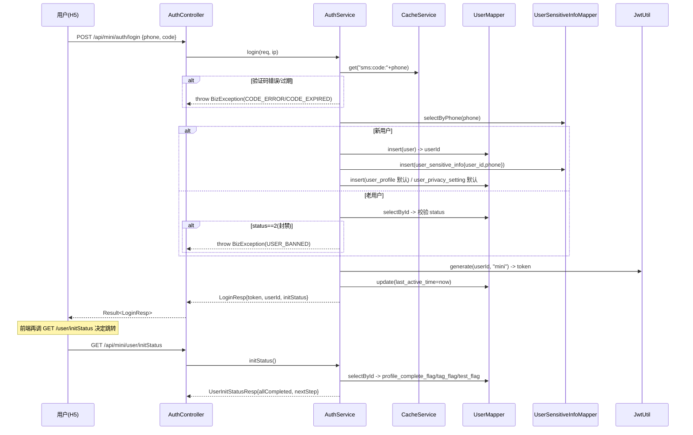
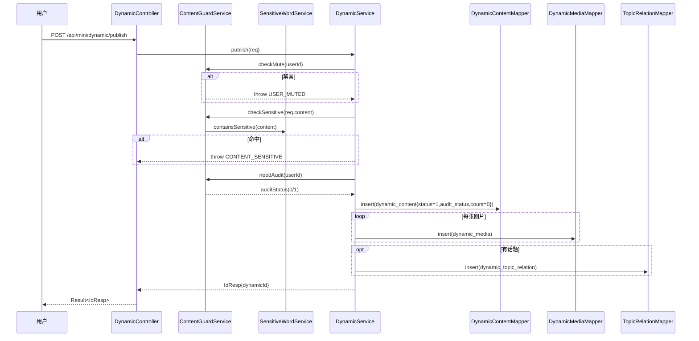
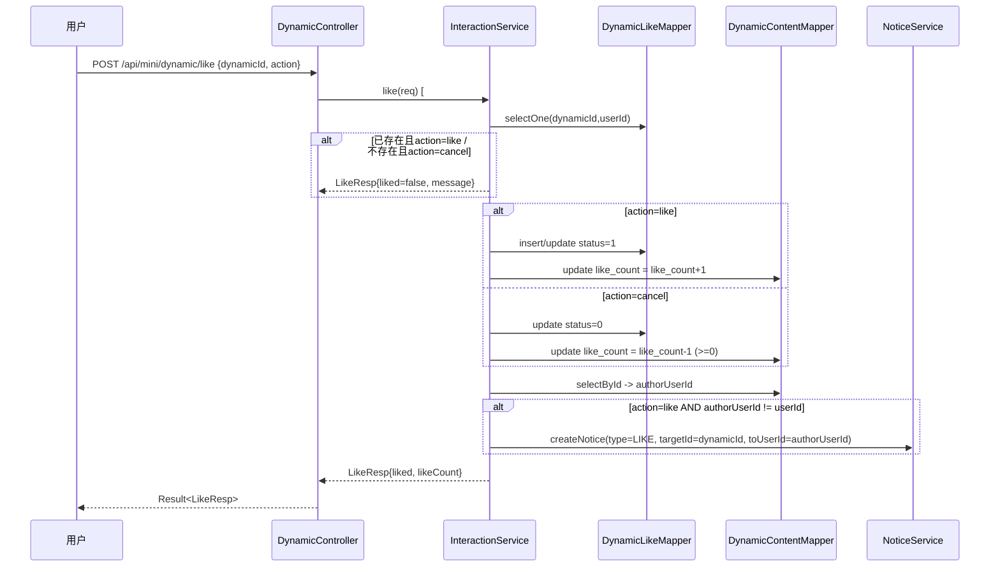
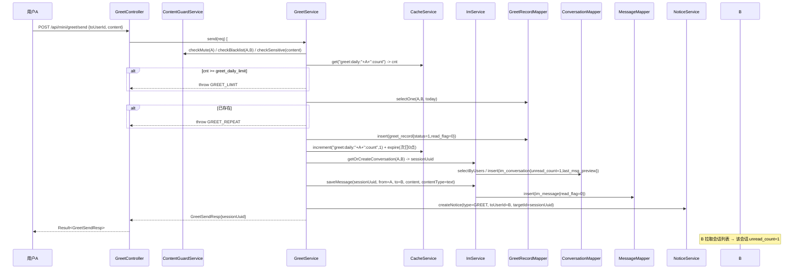
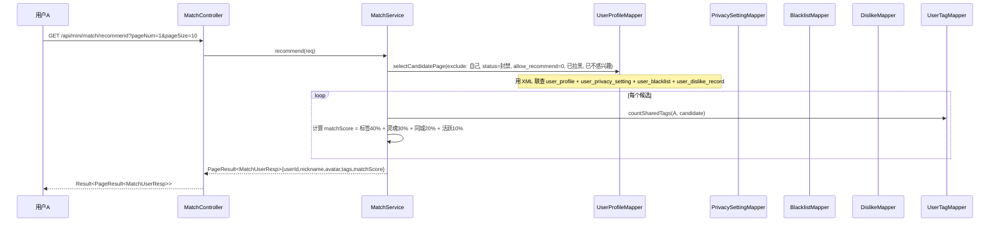

# Soul 风格年轻人社交系统一期 — 架构设计文档

| 项 | 内容 |
|---|---|
| 文档名称 | Soul 社交系统一期架构设计 |
| 文档版本 | v1.0 |
| 编写日期 | 2026-10-14 |
| 编写人 | 高见远（架构师） |
| 依赖输入 | `docs/01-需求文档.md`（PRD v1.0）、`CLAUDE.md` |
| 交付形态 | Java Spring Boot 3 后端 + Vue3 后台（Element Plus）+ Vue3 H5 用户端（Vant） |
| 本项目批次 | T04 / T05 / T06 → 产出 架构 + 表结构 + API + 任务分解 |

> 一句话定位：**一个「匿名/弱熟人身份 + 兴趣 + 灵魂测试」的真实可跑通社交系统**。本设计面向「工程师照着写代码即可落地」，所有接口、表结构、类结构均给出确定签名。

---

## 0. 本机环境实测基线（设计前提）

| 项 | 实测值 | 设计影响 |
|---|---|---|
| JDK | `C:\Program Files\Eclipse Adoptium\jdk-21.0.11.10-hotspot`（Java 21） | Spring Boot 3.2.5 + `maven.compiler.release=21` |
| Maven | `D:\BaiduNetdiskDownload\maven\apache-maven-3.9.16`，本地仓库 `C:\Users\WWb\.m2\repository` | 版本必须选本地仓库已缓存版本，避免拉不到包 |
| MySQL | 8.0.35，`localhost:3306`，root/123456 | 库名 `soul_social`（需新建），驱动 `mysql-connector-j` |
| Node | v22.22.2 | Vite 5 需要 Node ≥ 18，满足 |
| Redis | **未安装、6379 无进程** | **默认必须零 Redis 可启动** → `CacheService` 用内存实现 |

**本地仓库已确认可用版本**（避免工程师联网拉包失败）：
`spring-boot-starter-parent:3.2.5`、`mybatis-plus-spring-boot3-starter:3.5.7`、`jjwt:0.12.5`、`hutool-all:5.8.26`、`mysql-connector-j:8.3.0`、`spring-boot-starter-data-redis:3.3.0`、`spring-boot-starter-validation:3.2.5`、`knife4j-openapi3-jakarta-spring-boot-starter`。

---

## 1. 实施路径与技术选型

### 1.1 核心技术难点

| 难点 | 说明 | 应对方案 |
|---|---|---|
| **零 Redis 可启动** | 本机无 Redis，但鉴权 Token 与验证码需缓存 | 抽象 `CacheService` 接口，默认 `LocalCacheServiceImpl`（ConcurrentHashMap + 定时过期清理）；Redis 实现用 `@ConditionalOnProperty` 条件装配，**默认关闭** |
| **Spring Boot 3 包名迁移** | `javax.*` 全量改为 `jakarta.*` | 所有 Servlet/Validation 注解用 `jakarta.servlet.*`、`jakarta.validation.*`；MyBatis-Plus 必须用 `mybatis-plus-spring-boot3-starter`（**不是** `mybatis-plus-boot-starter`） |
| **敏感信息隔离** | 手机号/openid 不得出现在主表与任何 Resp | 独立 `user_sensitive_info` 表；`UserConverter` 中物理隔离字段，Resp 类**不含**该字段（编译期保证） |
| **计数冗余一致性** | 点赞/评论/收藏计数需与明细同事务 | 写明细 + `UPDATE ... count = count ± 1` 在同一 `@Transactional` 方法内 |
| **IM 复用既有表** | 严禁新造 chat 表 | 会话唯一键 `session_uuid`（两用户 id 排序拼接），沿用 `im_conversation` / `im_message` |
| **内容状态治理** | 封禁/禁言/拉黑/隐私/敏感词需逐口子拦截 | 统一 `ContentGuardService`（禁言/拉黑/敏感词/隐私），在 7 个写接口集中调用；R001–R014 逐条映射（见 §7） |
| **拉取式 IM** | 无 WebSocket | 前端轮询 `im/conversation/list` 与 `im/message/list`，未读数落库 |

### 1.2 技术选型表

| 层 | 技术 | 版本 | 选型理由 |
|---|---|---|---|
| 语言 | Java | 21 | CLAUDE.md 硬约束，本机已装 |
| 框架 | Spring Boot | **3.2.5** | 硬约束 3.2.x；本机仓库已缓存 |
| Web | spring-boot-starter-web | 随 Boot | REST + 内嵌 Tomcat |
| 校验 | spring-boot-starter-validation | 随 Boot | `jakarta.validation` 参数校验 |
| ORM | MyBatis-Plus | **3.5.7** | 硬约束；用 `mybatis-plus-spring-boot3-starter` |
| 数据库 | MySQL | 8.0.35 | 本机已装 |
| 驱动 | mysql-connector-j | **8.3.0** | 本地已缓存，兼容 MySQL 8 |
| 连接池 | HikariCP | 随 Boot | Boot 默认 |
| 鉴权 | jjwt (api/impl/jackson) | **0.12.5** | 轻量 JWT；本地已缓存 |
| 工具 | hutool-all | **5.8.26** | 加密/ID/日期工具 |
| 简化 | lombok | 随 Boot | Getter/Setter/Builder |
| 缓存 | spring-boot-starter-data-redis | **3.3.0** | **条件装配、默认不启用**，仅留依赖位 |
| 文档 | knife4j-openapi3-jakarta | 4.4.0 | Swagger UI，`jakarta` 版 |
| 日志 | logback + slf4j | 随 Boot | 默认 |
| 密码 | spring-security-crypto | 随 Boot | 仅用 `BCryptPasswordEncoder`，不引入完整 Security |
| 前端(后台) | Vue3 + Vite + Element Plus + Pinia + Axios | Vue 3.4 / Vite 5 / Element Plus 2.x | CLAUDE.md 约束 |
| 前端(H5) | Vue3 + Vite + Vant + Pinia + Axios | Vue 3.4 / Vite 5 / Vant 4 | CLAUDE.md 约束 |

> **强制提醒（易踩坑）**：
> 1. Spring Boot 3 → `jakarta.servlet.http.HttpServletRequest`（**不是** `javax.servlet`）。
> 2. MyBatis-Plus 依赖坐标必须是 `com.baomidou:mybatis-plus-spring-boot3-starter:3.5.7`。用错成 `mybatis-plus-boot-starter` 会因 `javax` 而启动失败。
> 3. jjwt 0.12.x API 与 0.9.x 不同：使用 `Jwts.builder()...signWith(key)` + `Jwts.parser().verifyWith(key).build().parseSignedClaims(token)`。

### 1.3 架构模式

- **分层架构（Layered）**：`Controller → Service（接口+impl）→ Mapper → DB`。
- **DTO 隔离**：`XxxReq`（入参）/ `XxxResp`（出参）/ `XxxDTO`（跨服务传输）/ `Entity`（仅 Mapper 与 Service 内部）。
- **横切能力**：拦截器（鉴权/上下文）+ 全局异常 + AOP 日志。
- **无状态鉴权**：JWT 无状态，当前用户放 `ThreadLocal`（`UserContext`），请求结束 `afterCompletion` 清理。

---

## 2. 模块与包结构

根包：`com.soul.social`。后端根目录：`backend/`。

```
backend/
├── pom.xml
└── src/main/
    ├── java/com/soul/social/
    │   ├── SoulSocialApplication.java            # 启动类
    │   ├── common/
    │   │   ├── result/
    │   │   │   ├── Result.java                   # 统一返回体 {code,message,data}
    │   │   │   ├── PageResult.java               # 分页返回体
    │   │   │   └── ResultCode.java               # 错误码枚举
    │   │   ├── exception/
    │   │   │   ├── BizException.java             # 业务异常
    │   │   │   └── GlobalExceptionHandler.java   # 全局异常处理(@RestControllerAdvice)
    │   │   └── constant/
    │   │       ├── CommonConstant.java           # 通用常量
    │   │       ├── RedisKeyConstant.java         # 缓存 key 前缀
    │   │       └── SysConfigKey.java             # system_config config_key 常量
    │   ├── config/
    │   │   ├── MybatisPlusConfig.java            # 分页插件 + 逻辑删除 + 自动填充
    │   │   ├── WebMvcConfig.java                 # 拦截器注册 + 静态资源映射
    │   │   ├── Knife4jConfig.java                # Swagger 分组
    │   │   ├── CacheConfig.java                  # CacheService 条件装配
    │   │   └── AsyncConfig.java                  # 通知/日志异步线程池
    │   ├── interceptor/
    │   │   ├── AuthInterceptor.java              # JWT 校验 + 用户上下文
    │   │   └── AdminAuthInterceptor.java         # 后台鉴权
    │   ├── context/
    │   │   ├── UserContext.java                  # ThreadLocal 当前用户
    │   │   └── LoginUser.java                    # 上下文对象(userId,adminFlag)
    │   ├── security/
    │   │   ├── JwtUtil.java                      # 签发/解析/校验
    │   │   └── PasswordUtil.java                 # BCrypt 封装
    │   ├── entity/                               # 36 张表对应实体(@TableName)
    │   │   ├── User.java
    │   │   ├── UserSensitiveInfo.java
    │   │   ├── UserProfile.java
    │   │   ├── ...(共 36 个)
    │   ├── mapper/                               # 每表一个 BaseMapper
    │   │   ├── UserMapper.java
    │   │   ├── ...(共 36 个)
    │   ├── service/
    │   │   ├── (接口定义，见 §3.3)
    │   │   └── impl/                             # @Service 实现
    │   ├── controller/
    │   │   ├── mini/                             # /api/mini/** 用户端
    │   │   │   ├── AuthController.java
    │   │   │   ├── UserController.java
    │   │   │   ├── TagController.java
    │   │   │   ├── SoulTestController.java
    │   │   │   ├── DynamicController.java
    │   │   │   ├── TopicController.java
    │   │   │   ├── MatchController.java
    │   │   │   ├── GreetController.java
    │   │   │   ├── ImController.java
    │   │   │   ├── NoticeController.java
    │   │   │   └── UploadController.java
    │   │   └── admin/                            # /api/admin/** 后台
    │   │       ├── AdminTagController.java
    │   │       └── AdminSoulTestController.java
    │   ├── dto/
    │   │   ├── req/                              # 所有 XxxReq
    │   │   └── resp/                             # 所有 XxxResp / XxxDTO
    │   ├── converter/                            # Entity <-> DTO 转换
    │   │   ├── UserConverter.java
    │   │   ├── DynamicConverter.java
    │   │   └── ImConverter.java
    │   ├── guard/                                # 治理横切
    │   │   └── ContentGuardService.java          # 禁言/拉黑/敏感词/隐私统一校验
    │   └── client/                               # 外部能力抽象
    │       ├── FileStorageService.java
    │       ├── impl/LocalFileStorageServiceImpl.java
    │       ├── CacheService.java
    │       ├── impl/LocalCacheServiceImpl.java
    │       ├── impl/RedisCacheServiceImpl.java   # 条件装配、默认关闭
    │       ├── SensitiveWordService.java
    │       ├── AiService.java
    │       └── impl/MockAiServiceImpl.java
    └── resources/
        ├── application.yml                       # 主配置
        ├── application-dev.yml                   # 开发环境
        ├── mapper/*.xml                          # 复杂 SQL（统计/联表）
        └── sensitive-words.txt                   # 敏感词种子词库
```

> 说明：`client/` 下放"外部依赖抽象"（文件/缓存/敏感词/AI），便于条件装配与后续替换；`guard/` 放治理横切逻辑，供各业务 Service 复用。

---

## 3. 分层与调用规范

### 3.1 职责边界

| 层 | 职责 | 禁止 |
|---|---|---|
| Controller | 参数绑定/`@Valid` 校验/调用 Service/包装 `Result`；**只出现 Req/Resp** | 写业务逻辑、直接调 Mapper、出现 Entity |
| Service | 业务编排、事务边界（`@Transactional`）、治理校验、调用 Mapper/其他 Service | 出现 HttpServletRequest 等 Web 对象 |
| Mapper | 单表 CRUD（`BaseMapper`）+ 复杂 SQL（XML） | 写业务判断 |
| Converter | Entity ↔ Resp/DTO 转换，**敏感字段在此物理隔离** | 写业务 |

### 3.2 Req/Resp 转换位置

- **入参**：Controller 接收 `XxxReq`（带 `jakarta.validation` 注解），Service 内转 Entity / 用 Entity 承载。
- **出参**：Service 返回 `XxxResp`/`XxxDTO`（**绝不放 Entity**）；转换在 Service 内调 `Converter`。
- **兜底保障**：即使 Service 误返回 Entity，`GlobalExceptionHandler` 捕获 `ResultCode.SYSTEM_ERROR`；并新增编译约定：Controller 方法签名不得出现实体类型（见 §10 共享约定）。

### 3.3 Service 接口清单（关键签名）

```java
// 账号
public interface AuthService {
    LoginResp login(LoginReq req, String clientIp);
    void logout();
}
// 用户资料/隐私/黑名单
public interface UserService {
    UserInitStatusResp initStatus();
    UserProfileResp getMyProfile();
    UserProfileResp completeProfile(ProfileCompleteReq req);
    UserProfileResp updateProfile(ProfileUpdateReq req);
    UserHomeResp getUserHome(Long userId);
}
public interface PrivacyService { void update(PrivacyUpdateReq req); }
public interface BlacklistService {
    void add(BlacklistAddReq req); void remove(BlacklistRemoveReq req);
    boolean isBlacklisted(Long userId, Long targetUserId); // 双向判断
}
// 标签
public interface TagService {
    TagListResp listTags();
    void saveUserTags(UserTagSaveReq req);
    void adminCrud(AdminTagReq req);
}
// 灵魂测试
public interface SoulTestService {
    SoulQuestionListResp questions();
    SoulTestResultResp submit(SoulTestSubmitReq req);
    SoulTestResultResp myResult();
    void adminCrud(AdminSoulTestReq req);
}
// 广场
public interface DynamicService {
    Long publish(DynamicPublishReq req);
    PageResult<DynamicItemResp> list(DynamicListReq req);
    DynamicDetailResp detail(Long id);
    void delete(Long id, Long userId);
}
// 互动
public interface InteractionService {
    LikeResp like(DynamicLikeReq req);
    CollectResp collect(DynamicCollectReq req);
    CommentResp comment(DynamicCommentReq req);
    PageResult<CommentResp> commentList(CommentListReq req);
}
// 话题
public interface TopicService { TopicListResp listTopics(); }
// 匹配
public interface MatchService {
    PageResult<MatchUserResp> recommend(MatchRecommendReq req);
    void dislike(MatchDislikeReq req);
}
// 打招呼
public interface GreetService { GreetSendResp send(GreetSendReq req); }
// IM
public interface ImService {
    PageResult<ConversationResp> conversationList(ConversationListReq req);
    PageResult<MessageResp> messageList(MessageListReq req);
    MessageSendResp send(MessageSendReq req);
    void read(ConversationReadReq req);
}
// 通知
public interface NoticeService {
    PageResult<NoticeResp> list(NoticeListReq req);
    void read(NoticeReadReq req);
}
```

---

## 4. 鉴权设计

### 4.1 JWT 签发/校验

| 项 | 方案 |
|---|---|
| 算法 | HMAC-SHA256（`jjwt` 0.12.5，`Keys.hmacShaKeyFor(secretBytes)`） |
| Claims | `sub`=userId，`type`=mini/admin，`iat`，`exp` |
| 有效期 | 用户端 7 天（`system_config.token_expire_days`）；后台 1 天 |
| 密钥 | `application.yml` → `soul.jwt.secret`（≥32 字节）；生产用环境变量覆盖 |
| Token 载体 | HTTP Header `Authorization: Bearer <token>` |
| 存 Redis/内存 | **无状态**，不在服务端存 session；可选把 token 黑名单放 `CacheService`（登出时写入，key `logout:token:{token}`，TTL=剩余有效期） |

### 4.2 拦截器实现

```java
// AuthInterceptor（用户端）
// 1. preHandle：取 Header Authorization → 去掉 Bearer → JwtUtil.parse
//    - 无 token / 解析失败 / 过期 → 抛 BizException(UNAUTHORIZED)
//    - 命中登出黑名单 → 抛 BizException(UNAUTHORIZED)
//    - 解析出 userId → UserContext.set(new LoginUser(userId))
//    - 查 user.status：封禁(2) → 抛 BizException(USER_BANNED)
// 2. afterCompletion：UserContext.clear()（防线程池串号）
```

- **用户端拦截器** `AuthInterceptor` 注册路径：`/api/mini/**`，白名单：
  `/api/mini/auth/login`、`/api/mini/upload/**`（如需匿名）、`/doc.html`、`/swagger-ui/**`、`/v3/api-docs/**`。
- **后台拦截器** `AdminAuthInterceptor` 注册路径：`/api/admin/**`，校验 `type=admin`。

### 4.3 当前用户上下文

```java
public final class UserContext {
    private static final ThreadLocal<LoginUser> HOLDER = new ThreadLocal<>();
    public static void set(LoginUser u){ HOLDER.set(u); }
    public static LoginUser get(){ return HOLDER.get(); }
    public static Long getUserId(){ LoginUser u=HOLDER.get(); return u==null?null:u.getUserId(); }
    public static void clear(){ HOLDER.remove(); }
}
```

---

## 5. 统一返回与异常

### 5.1 Result / PageResult

```java
public class Result<T> {           // {code:int, message:String, data:T}
    private Integer code; private String message; private T data;
    public static <T> Result<T> success(T data);
    public static <T> Result<T> success();
    public static <T> Result<T> fail(ResultCode rc);
    public static <T> Result<T> fail(Integer code, String msg);
}
public class PageResult<T> {       // 分页统一结构
    private Long total; private Long pageNum; private Long pageSize;
    private List<T> records;
    public static <T> PageResult<T> of(IPage<T> page);
}
```

### 5.2 错误码枚举（示例，完整表见 API 文档）

| code | 枚举 | message |
|---|---|---|
| 200 | SUCCESS | 操作成功 |
| 400 | PARAM_ERROR | 参数校验失败 |
| 401 | UNAUTHORIZED | 未登录或登录已过期 |
| 403 | FORBIDDEN | 无权限访问 |
| 404 | NOT_FOUND | 资源不存在 |
| 500 | SYSTEM_ERROR | 系统繁忙，请稍后重试 |
| 1001 | CODE_ERROR | 验证码错误 |
| 1002 | CODE_EXPIRED | 验证码已过期 |
| 1003 | USER_BANNED | 账号已被封禁 |
| 1004 | USER_MUTED | 账号已被禁言 |
| 1005 | PROFILE_INCOMPLETE | 资料未完善 |
| 2001 | TAG_COUNT_INVALID | 标签数量须为 3-10 个 |
| 3001 | TEST_ALREADY_SUBMITTED | 请勿重复提交测试 |
| 4001 | CONTENT_SENSITIVE | 内容含违规信息 |
| 4002 | DYNAMIC_NOT_FOUND | 瞬间不存在或已删除 |
| 4003 | NO_PERMISSION_DELETE | 仅可删除自己的内容 |
| 5001 | ALREADY_LIKED | 请勿重复操作 |
| 6001 | BLACKLISTED | 对方已拉黑你或你已拉黑对方 |
| 6002 | STRANGER_MSG_CLOSED | 对方未开启陌生人私信 |
| 7001 | GREET_LIMIT | 打招呼已达今日上限 |
| 7002 | GREET_REPEAT | 今日已向该用户打过招呼 |
| 8001 | RECOMMEND_CLOSED | 对方已关闭被推荐 |

### 5.3 全局异常处理器

```java
@RestControllerAdvice
public class GlobalExceptionHandler {
    @ExceptionHandler(BizException.class)      // 业务异常 → 对应 code
    public Result<Void> handleBiz(BizException e){...}
    @ExceptionHandler(MethodArgumentNotValidException.class) // 参数校验
    public Result<Void> handleValid(MethodArgumentNotValidException e){...}
    @ExceptionHandler(ConstraintViolationException.class)
    public Result<Void> handleConstraint(ConstraintViolationException e){...}
    @ExceptionHandler(Exception.class)         // 兜底
    public Result<Void> handleException(Exception e){ log.error(...); }
}
```

---

## 6. 公共能力设计

### 6.1 FileStorageService（文件存储抽象）

```java
public interface FileStorageService {
    /** 上传，返回可访问 URL */
    String upload(MultipartFile file, String bizType);
    void delete(String url);
}
```

**LocalFileStorageServiceImpl（默认实现）**
- 存储根目录：`${soul.file.local.base-dir:./upload}`（相对后端运行目录）。
- 目录结构：`{baseDir}/{bizType}/{yyyyMM}/{uuid}.{ext}`（如 `./upload/avatar/202610/ab12.png`）。
- 校验：后缀白名单 `jpg/jpeg/png/gif/webp`；大小上限 `soul.file.local.max-size=5MB`。
- URL 生成：`{soul.file.local.domain}/upload/{bizType}/{yyyyMM}/{uuid}.{ext}`（domain 默认空串 → 返回相对路径 `/upload/...`，由前端拼 baseURL）。
- **静态资源映射**（`WebMvcConfig`）：`registry.addResourceHandler("/upload/**").addResourceLocations("file:" + baseDir + "/")`。
- 预留：`OssFileStorageServiceImpl` 位（`@ConditionalOnProperty(soul.file.storage=oss)`，本期不实现）。

### 6.2 CacheService（缓存抽象）

```java
public interface CacheService {
    void set(String key, String value, long ttlSeconds);
    String get(String key);
    boolean delete(String key);
    boolean hasKey(String key);
    long increment(String key, long delta);   // 频控计数用
    boolean expire(String key, long ttlSeconds);
}
```

**LocalCacheServiceImpl（默认实现）**
- 底层 `ConcurrentHashMap<String, CacheEntry>`，`CacheEntry{value, expireAt(epochMs)}`。
- 读取时惰性判过期；另起 `@Scheduled(fixedDelay=60000)` 或守护线程清理过期 key。
- `increment`：对数值型 value 原子累加（`Long.parseLong`），支持频控计数。
- 装配：`@ConditionalOnProperty(name="soul.cache.type", havingValue="local", matchIfMissing=true)`。

**RedisCacheServiceImpl（预留）**
- `@ConditionalOnProperty(name="soul.cache.type", havingValue="redis")`，依赖 `StringRedisTemplate`。
- `pom.xml` 带 `spring-boot-starter-data-redis` 但**默认不启用**：无需 Redis 即可启动。

### 6.3 SensitiveWordService（敏感词过滤）

```java
public interface SensitiveWordService {
    /** 是否命中敏感词 */
    boolean containsSensitive(String text);
    /** 命中的敏感词列表（用于审计记录） */
    List<String> hitWords(String text);
    /** 替换为 * */
    String replace(String text);
}
```
- 实现：`LocalSensitiveWordServiceImpl`，启动时加载 `resources/sensitive-words.txt`（每行一词）到 `Set`；一期用简单 `contains` 遍历（词量小），预留 DFA/Trie 优化位。
- 种子词：内置基础违规词（如脏话、诈骗、广告类最小集合，见 `schema.sql` 种子）。

### 6.4 AiService（AI 能力抽象）

```java
public interface AiService {
    /** 生成打招呼话术建议（本期 Mock 兜底） */
    String suggestGreet(Long fromUserId, Long toUserId, List<String> sharedTags);
    /** AI 聊天（本期不实现，留接口位） */
    String chat(Long userId, Long roleId, String message);
}
```
- `MockAiServiceImpl`：基于共享标签拼模板话术；`chat` 返回固定自然兜底语。**本期不调百炼 DashScope**。

### 6.5 SysConfigService（系统配置读取，含默认值兜底）

```java
public interface SysConfigService {
    /** 读取配置（字符串），查不到或已禁用返回 defaultVal，不抛异常 */
    String get(String key, String defaultVal);
    /** 读取整型配置，解析失败返回 defaultVal */
    Integer getInt(String key, Integer defaultVal);
    /** 读取布尔配置（"1"/"true"/"0"/"false"），否则返回 defaultVal */
    Boolean getBool(String key, Boolean defaultVal);
    /** 新增或更新配置值 */
    void set(String key, String value);
}
```
- **实现要求**：`SysConfigServiceImpl` 每次读取时查 `system_config`（`status=1` 且 `is_delete=0`）；**查不到一律返回 `defaultVal`，绝不抛异常**，保证缺配置项时系统可正常运行。
- 各业务 Service 通过 `SysConfigKey` 常量 + `get(key, defaultVal)` 读取（如 `sysConfig.getInt(SysConfigKey.GREET_DAILY_LIMIT, 20)`）。
- 为减少 DB 压力，可用 `CacheService` 做短 TTL（如 60s）缓存；本期数据量小，直查亦可。

---

## 7. 状态与治理实现方案（R001–R014 映射）

统一入口：`ContentGuardService`。各业务 Service 在写操作前调用对应方法。

| 规则 | 触发场景 | 实现位置（方法） | 校验逻辑 |
|---|---|---|---|
| R001 封禁 | 全部写接口 + 登录 | `AuthInterceptor.preHandle` + `AuthService.login` | `user.status==2` → `USER_BANNED`；登录直接拒绝 |
| R002 禁言 | 发动态/评论/消息/打招呼 | `ContentGuardService.checkMute(userId)`，被 `DynamicService.publish`、`InteractionService.comment`、`ImService.send`、`GreetService.send` 调用 | 查 `user.mute_end_time > now()` → `USER_MUTED` |
| R003 风控观察 | 发布类接口 | `ContentGuardService.needAudit(userId)`，`DynamicService.publish` 调用 | `user.risk_level>=1` → `audit_status=1`(待审)；否则 `0`(已过) |
| R004 黑名单 | 打招呼/私信/推荐/评论 | `ContentGuardService.checkBlacklist(a,b)`，被 `GreetService.send`、`ImService.send`、`MatchService.recommend`、`InteractionService.comment` 调用 | `user_blacklist` 双向命中 → `BLACKLISTED` |
| R005 关闭被推荐 | 推荐池 | `MatchService.recommend` | 目标 `user_privacy_setting.allow_recommend=0` → 排除 |
| R006 关闭陌生人私信 | 私信 | `ContentGuardService.checkStrangerMsg(from,to)`，`ImService.send` 调用 | 双方无会话且目标 `allow_stranger_msg=0` → `STRANGER_MSG_CLOSED` |
| R007 动态待审核 | 广场列表/详情 | `DynamicService.list/detail` | `audit_status=1` 且非本人 → 不展示 |
| R008 平台下架 | 广场列表/详情 | `DynamicService.list/detail` | `status=2`(下架) → 非本人不可见（后台后续） |
| R009 评论删除 | 评论列表 | `InteractionService.commentList`；作者删除 `DynamicService`/`InteractionService` | `is_delete=1` 不展示；仅作者可删（本期） |
| R010 敏感词 | 昵称/签名/动态/评论/消息 | `ContentGuardService.checkSensitive(text)`，被 profile 保存、`DynamicService.publish`、`InteractionService.comment`、`ImService.send` 调用 | `SensitiveWordService.containsSensitive` → `CONTENT_SENSITIVE` |
| R011 举报重复 | 举报接口 | **本期无举报接口**（后续批次），仅建 `report_record` 表 | — |
| R012 AI 失败 | AI 接口 | `MockAiServiceImpl` 内部兜底 | 本期不调外部 |
| R013 通知已读 | 通知已读 | `NoticeService.read` | 校验 `user_notice.user_id==当前用户` → `read_flag=1`；支持单条/全部 |
| R014 打招呼频控 | 打招呼 | `GreetService.send` | 每日总量超 `system_config.greet_daily_limit` → `GREET_LIMIT`；同人当日已发 → `GREET_REPEAT` |

> **user 表分流字段设计说明**：需求文档 user 表仅提 `profile_complete_flag`。为支持登录分流（A001/A002），本设计在 `user` 表**显式增加 `tag_flag` 与 `test_flag`**（`TINYINT DEFAULT 0`），在资料完善/标签保存/测试提交时置 1。选择理由：① 分流查询只读 user 一张表，性能好；② 避免 `user_tag`/`user_soul_test_record` 存在性判断的额外 JOIN；③ 与 `profile_complete_flag` 语义对齐、便于后台展示。三个 flag 与"存在性"保持同步（保存标签时同时写 `user_tag` 并置 `tag_flag=1`）。

---

## 8. 关键流程时序图

### 8.1 登录 + 初始化分流



### 8.2 发布瞬间（敏感词 + 禁言 + 审核状态）



### 8.3 点赞（幂等 + 计数 + 通知；自己赞自己不通知）



### 8.4 打招呼转会话（greet → conversation → message → notice）



### 8.5 推荐用户（排除规则 + 匹配度）



---

## 9. 依赖包清单（可直接抄进 pom.xml）

```xml
<!-- 父 -->
<parent>
  <groupId>org.springframework.boot</groupId>
  <artifactId>spring-boot-starter-parent</artifactId>
  <version>3.2.5</version>
</parent>
<properties>
  <java.version>21</java.version>
  <maven.compiler.release>21</maven.compiler.release>
  <mybatis-plus.version>3.5.7</mybatis-plus.version>
  <jjwt.version>0.12.5</jjwt.version>
  <hutool.version>5.8.26</hutool.version>
</properties>
```

| groupId | artifactId | version | 用途 |
|---|---|---|---|
| org.springframework.boot | spring-boot-starter-web | 随 Boot | Web MVC |
| org.springframework.boot | spring-boot-starter-validation | 随 Boot | 参数校验(jakarta) |
| org.springframework.boot | spring-boot-starter-aop | 随 Boot | AOP 日志 |
| com.baomidou | **mybatis-plus-spring-boot3-starter** | 3.5.7 | ORM（**Spring Boot 3 专用**） |
| com.mysql | mysql-connector-j | 8.3.0 | MySQL 驱动 |
| org.springframework.boot | spring-boot-starter-data-redis | 3.3.0 | **默认不启用**，仅留依赖位 |
| io.jsonwebtoken | jjwt-api | 0.12.5 | JWT |
| io.jsonwebtoken | jjwt-impl | 0.12.5 | JWT（runtime） |
| io.jsonwebtoken | jjwt-jackson | 0.12.5 | JWT JSON（runtime） |
| cn.hutool | hutool-all | 5.8.26 | 工具 |
| org.projectlombok | lombok | 随 Boot（provided） | 简化 |
| org.springframework.security | spring-security-crypto | 随 Boot | BCrypt 密码 |
| com.github.xiaoymin | knife4j-openapi3-jakarta-spring-boot-starter | 4.4.0 | 接口文档（可选） |

> `application.yml` 关键配置：`soul.cache.type=local`（默认）、`soul.file.storage=local`、`soul.jwt.secret`、`server.port=8080`、`spring.datasource`（`soul_social`）。

---

## 10. 共享知识约定（跨文件统一）

| 类别 | 约定 |
|---|---|
| 返回体 | 一律 `Result<T>{code:int, message:String, data:T}`；`code=200` 成功 |
| 分页 | 请求统一 `pageNum`（从 1 起）/`pageSize`；响应统一 `PageResult<T>{total,pageNum,pageSize,records}` |
| 时间 | 出参统一 `yyyy-MM-dd HH:mm:ss`（`@JsonFormat`）；库内存 `DATETIME`；入参生日 `yyyy-MM-dd` |
| 布尔 | 库内 `TINYINT`(0/1)，出参转 `Boolean`，字段名不带 `is` 前缀输出时保留语义（如 `showCity`） |
| 逻辑删除 | `is_delete`：0=正常，1=删除；MyBatis-Plus 全局配置 `logic-delete-field=isDelete` |
| 用户状态 | `user.status`：1=正常，2=封禁 |
| 动态状态 | `dynamic_content.status`：1=正常，2=下架；`audit_status`：0=已过审，1=待审核 |
| 点赞/收藏动作 | 请求 `action`：`like/cancel`、`collect/cancel`（或 `1/0`），响应回显最终状态 |
| 通知类型 | `notice_type`：1=点赞，2=评论，3=回复，4=打招呼，5=系统，6=审核 |
| 会话类型 | `im_conversation.session_type`：1=普通，2=打招呼，3=AI |
| 消息类型 | `im_message.content_type`：text/image/voice（**本期仅 text**，枚举预留） |
| IM 会话唯一键 | `session_uuid = min(uidA,uidB) + "_" + max(uidA,uidB)` |
| 敏感字段 | `user_sensitive_info{phone,openid,unionid}` **禁止**出现在任何 Resp |
| 命名 | Req/Resp/DTO 后缀严格区分；Service 接口 + `Impl` 实现 |
| 注入 | 全部 `@Resource` 字段注入，禁止 `@Autowired` / 构造器注入 |
| 统计字段 | `like_count/comment_count/collect_count/report_count` 冗余，写操作与计数同事务 |

---

## 11. 待明确事项

| 编号 | 事项 | 现状/默认方案 | 影响 |
|---|---|---|---|
| U1 | 短信通道 | 开发模式固定验证码 `123456`，`system_config.sms_enable=0` 开关 | 登录验收 |
| U2 | 图片存储 | 默认本地磁盘 + 静态映射，`FileStorageService` 预留 OSS 位 | 头像/动态图 |
| U3 | 匹配度权重 | 标签 40% + 灵魂 30% + 同城 20% + 活跃 10%，权重写入 `system_config` | 推荐结果 |
| U4 | 「同城」判定 | 按 `user_profile.city` 精确匹配 | 广场同城频道 |
| U5 | 后台账号 | 默认 `admin/123456`（BCrypt 存储），后续接入后台登录接口 | 后台可用性 |
| U6 | 后台动态/用户管理 | 本期不实现，仅建表 + 预留 Controller 位 | 范围边界 |
| U7 | 会话隐藏/删除 | 本期仅做"标记已读"，隐藏/删除会话留后续 | IM 完整性 |
| U8 | 敏感词词库量 | 种子词最小集合，后续后台维护 | 拦截覆盖度 |

---

## 12. 交付物清单

| 文件 | 说明 |
|---|---|
| `docs/02-架构设计.md` | 本文件 |
| `sql/schema.sql` | 建库建表 DDL + 种子数据（36 表） |
| `docs/03-API接口文档.md` | 全部接口规格（用户端 + 后台） |
| `docs/02-任务列表.md` | 有序任务分解与依赖图（T07–T15） |

*文档结束 — v1.0*
